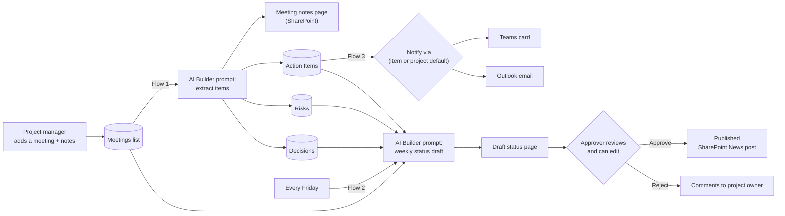

# Architecture

Everything runs inside your Microsoft 365 tenant: SharePoint for storage and pages, Power Automate for the
logic, AI Builder for the AI step, and Teams/Outlook/Approvals for people. No servers and no custom code to host.

## Lists (created by `provisioning/Setup-MinuteMate.ps1`)

| List | Purpose | Key columns |
|---|---|---|
| Projects | One row per project; settings | Project Owner, Status Approver, Default Notify Via, Overall Status, Weekly Status On |
| Meetings | Intake: the "meetings to capture" list | Project, Meeting Date, Attendees, Raw Notes, AI Summary, Processing Status, Meeting Notes Page |
| Action Items | Tasks from meetings or added by hand | Owner, Due Date, Status, Priority, Notify Via, Notified |
| Risks | Running risk log | Impact, Likelihood, Mitigation, Owner, Status |
| Decisions | Running decision log | Decision Date, Decided By, Rationale |
| Status Updates | One row per weekly draft | Week Of, Overall Status, Draft Page, Approval Status, Reviewer Comments, Published News Post |

## Design choices

- **Human in the loop.** The AI never publishes. Status posts wait for approval; meetings it isn't sure about
  are marked **Needs review**.
- **Owners are resolved, not guessed.** If a name matches nobody or several people, the item goes to the project
  owner and keeps the name as written so they can reassign it.
- **Notification channel is a setting, not code.** Project default, overridable per action item.
- **Pages, not .html files.** SharePoint downloads .html files; modern pages render and can be News.

## Roadmap

| Phase | Scope | Status |
|---|---|---|
| 1 | Notes → summary, actions, risks, decisions; owner notifications | This kit |
| 2 | Weekly status draft → approval → News post | This kit |
| 3 | Pick Teams meetings to capture; pull the transcript or recap automatically | Next |
| 4 | Kickoff kit, timeline and dependency view, portfolio dashboard (Power Apps / Power BI) | Later |
