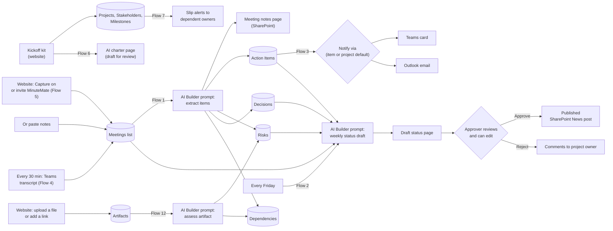

# Architecture

Everything runs inside your Microsoft 365 tenant: SharePoint for storage and pages, Power Automate for the
logic, AI Builder for the AI step, and Teams/Outlook/Approvals for people. No servers and no custom code to host.

## Lists (created by `provisioning/Setup-MinuteMate.ps1`)

| List | Purpose | Key columns |
|---|---|---|
| Projects | One row per project; settings | Project Owner, Status Approver, Default Notify Via, Overall Status, Weekly Status On |
| Meetings | Intake: the "meetings to capture" list | Project, Meeting Date, Attendees, Raw Notes, AI Summary, Processing Status, Meeting Notes Page |
| Action Items | Tasks from meetings or added by hand | Owner, Due Date, Status, Priority, Notify Via, Notified |
| Artifacts | Files and links added for assessment | Artifact Type, Link, File Name, Text or Notes, Assessment Status, Assessment Summary |
| Risks | Running risk log | Impact, Likelihood, Mitigation, Owner, Status, Source Meeting or Source Artifact |
| Dependencies | What the project waits on | Type, Provided By, Needed By, Status, Impact, Related Milestone, Source Meeting or Source Artifact |
| Decisions | Running decision log | Decision Date, Decided By, Rationale |
| Status Updates | One row per weekly draft | Week Of, Overall Status, Draft Page, Approval Status, Reviewer Comments, Published News Post |
| Milestones | Timeline and dependencies | Workstream, Start Date, Due Date, Status, Owner Email, Gate, Depends On (multi-lookup) |
| Stakeholders | Kickoff kit: people and RACI | Email, Role, RACI, Influence |
| Kickoffs | Kickoff kit → charter | Goal, Scope, Out of Scope, Success Metrics, Constraints, Status, Charter Page |

The website also uses: Projects → Project Code, Auto-capture Keywords, Start/Target Date, Owner/Approver Email;
Meetings → Capture Mode, Meeting Start/End, Teams Join Link, Organizer Email, Series Id, Transcript Attempts;
Action Items → Owner Email.

Phase 5 adds: Projects → Track Work In, Tracker Target, Transcript Retention (days), Post Recap to Meeting Chat,
Post Agenda Before Meeting; Meetings → Teams Meeting Chat Id, Recap Posted, Agenda Posted, Transcript Purged;
Action Items → Source, Closed Date, Tracker Item Id, Tracker Item, Sync State, Seen in Meetings.

## Design choices

- **Human in the loop.** The AI never publishes. Status posts wait for approval; meetings it isn't sure about
  are marked **Needs review**.
- **Owners are resolved, not guessed.** If a name matches nobody or several people, the item goes to the project
  owner and keeps the name as written so they can reassign it.
- **Notification channel is a setting, not code.** Project default, overridable per action item.
- **Pages, not .html files.** SharePoint downloads .html files; modern pages render and can be News.

## Roadmap

| Phase | Scope | Status |
|---|---|---|
| 1 | Notes → summary, actions, risks, decisions; owner notifications | This kit |
| 2 | Weekly status draft → approval → News post | This kit |
| 3 | Pick meetings to capture (single, series, keyword rules, or invite MinuteMate); transcript queue with retry; Flow 4 sweeps for transcripts | This kit (Flow 4 needs admin setup) |
| 4 | Kickoff kit with AI charter, timeline and dependency view with slip alerts, full tracker | This kit |
| 5 | Tracker sync (Planner, Azure DevOps, GitHub), meeting-chat recap and agenda, actionable cards, duplicate checking, AI eval, privacy and retention, Impact tab, packaging and Teams app | This kit (see `docs/roadmap.md`) |
| 6 | Simple setup: layered README, Flow 0, setup check, IT request | This kit |
| 7 | Risks & dependencies tab: assess files, links and meeting notes; ranked "needs attention" list linked from the Overview | This kit (Flow 12: guide) |
| Later | Portfolio view across projects, Power BI reporting, Teams single sign-on | Ideas |
